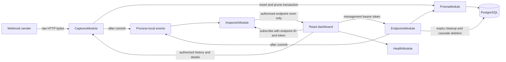

# HookLens

A small, real-time webhook inspector for developers. Generate a temporary URL,
send it a request, and inspect exactly what arrived without refreshing the page.

HookLens is a modular NestJS application with PostgreSQL persistence and a minimal
React dashboard. Anonymous endpoints are temporary: **do not send production secrets**.

## Features

- Independent, cryptographically random public URLs and management tokens.
- GET, POST, PUT, PATCH, and DELETE capture with exact raw bodies up to 256 KiB.
- Headers, repeated query parameters, content type, source IP, and timestamps.
- Authorized history, pagination, method filtering, and text/Base64 inspection.
- Authorized Socket.IO rooms, live captures, clear-history, and expiry notifications.
- 24-hour expiry, periodic cleanup, cascading deletion, and 100 captures per endpoint.
- Dark, responsive dashboard with credentials kept in sessionStorage.
- Swagger, strict TypeScript, ESLint, Prettier, and real PostgreSQL integration tests.

## Stack and architecture

NestJS 12, Prisma 7 with the PostgreSQL driver adapter, PostgreSQL 17, Socket.IO 4,
React 19, Vite 8, Tailwind CSS 4, Lucide, Jest, and Supertest. Versions are pinned in
workspace manifests and the lockfile. TypeScript 5.9 is pinned for tooling compatibility.
The API compiles to CommonJS and uses Node's supported require(esm) interoperability
for NestJS 12. Jest integration tests enable Node VM modules.



Controllers handle routing and validation; services own authorization and database
operations. Captures lock their endpoint row during insertion and pruning. Clearing
history takes the same lock. History selects summary fields without loading bodies;
a repeatable-read transaction keeps page contents and totals consistent.

```text
apps/
  api/
    prisma/                     Schema and tracked SQL migrations
    prisma.config.ts            Prisma 7 connection configuration
    src/
      captures/                 Raw capture, history, details, and deletion
      common/                   Errors, rate limits, and local event notifications
      endpoints/                Creation, token security, and expiry cleanup
      health/                   Process health check
      inspector/                Socket.IO adapter, gateway, and subscription DTO
      prisma/                   Database client and connection lifecycle
      generated/prisma/         Generated client (ignored)
    test/                       Jest + Supertest + Socket.IO integration tests
  web/
    src/                        React dashboard and session/connection state
    test/                       React/jsdom integration against the real API
.env.example
compose configuration: docker-compose.yml
```

## Prerequisites

- Node.js 24.11+ and npm 11+; an active Node LTS release is recommended.
- Docker with the Compose plugin, or an existing PostgreSQL 17+ instance.
- Two separate databases for development and integration testing.

Use `npm.cmd` and `curl.exe` in Windows PowerShell if its aliases or execution policy
interfere with `npm` and `curl`. No global packages are required.

## Install and configure

Run these commands at the repository root. Copy the environment file only if you
have not already configured one.

```sh
npm ci
cp .env.example .env
```

In PowerShell, the copy command is `Copy-Item .env.example .env`.
Edit `.env`: choose a local PostgreSQL password and set the same URL-encoded password
in the two database URLs. Never commit this file.

| Variable             | Purpose / default in example                                     |
| -------------------- | ---------------------------------------------------------------- |
| `POSTGRES_USER`      | Local Compose database role: `hooklens`                          |
| `POSTGRES_PASSWORD`  | Replace the local password placeholder                           |
| `POSTGRES_DB`        | Development database: `hooklens`                                 |
| `DATABASE_URL`       | Required PostgreSQL connection URL for the API and migrations    |
| `TEST_DATABASE_URL`  | Separate, disposable test database; its name must end in `_test` |
| `PORT`               | API port: `3000`                                                 |
| `PUBLIC_BASE_URL`    | API HTTP(S) origin used for generated webhook URLs               |
| `FRONTEND_ORIGIN`    | Exact allowed browser origin: `http://localhost:5173`            |
| `CAPTURE_RATE_LIMIT` | Captures per direct source IP per minute: `120`                  |
| `CREATE_RATE_LIMIT`  | Endpoint creations per direct source IP per minute: `10`         |
| `VITE_API_URL`       | API origin compiled into the frontend: `http://localhost:3000`   |

Origins must have no path or trailing slash. Configuration is loaded from the root
`.env` regardless of workspace commands and validated at API startup. The frontend
reads `VITE_API_URL` at build/start time; restart Vite after changing it.

## PostgreSQL and migrations

```sh
docker compose up -d postgres
npm run db:generate
npm run db:deploy
```

Compose binds PostgreSQL to `127.0.0.1:5432` and persists it in a named volume. For
an existing PostgreSQL server, create the development database and configure its
connection URL instead of running Compose.

`db:generate` creates the ignored Prisma client; run it after every fresh install
or schema change. `db:deploy` applies tracked migrations without resetting data.
For a schema change during development:

```sh
npm exec --workspace @hooklens/api -- prisma migrate dev --name describe_change
npm run db:generate
```

Do not reset a database that contains data you need. `docker compose stop` preserves
the local volume; `docker compose down` also preserves it unless volumes are explicitly
removed. Do not remove that volume when you want to keep captures.

## Run locally

Start the API and dashboard in separate terminals:

```sh
npm run dev:api
```

```sh
npm run dev:web
```

Open **http://localhost:5173**, click **Generate webhook**, and copy the public URL.
Send a request using curl or Postman. The request appears automatically; select it
and use Overview, Headers, Query, or Body. Body supports formatted JSON, raw text,
and exact Base64. You can filter methods, clear history, or delete the endpoint.

- Swagger: **http://localhost:3000/api/docs**
- OpenAPI JSON: **http://localhost:3000/api/docs-json**
- Health: **http://localhost:3000/api/health**

The API development process recompiles TypeScript and restarts on source changes.
Vite handles frontend changes. For a production build:

```sh
npm run build
npm run start --workspace @hooklens/api
```

Serve `apps/web/dist` with a static web server at the configured frontend origin.
External webhook providers require a publicly reachable HTTPS API origin; localhost
is intended for requests from your own machine. Update `PUBLIC_BASE_URL` accordingly.

## API reference

Only endpoint creation, webhook delivery, health, and API documentation are public.
All endpoint-specific management routes require `Authorization: Bearer <managementToken>`.

| Method                        | Route                                    | Success | Description                                    |
| ----------------------------- | ---------------------------------------- | ------- | ---------------------------------------------- |
| POST                          | `/api/endpoints`                         | 201     | Create a 24-hour endpoint; no input fields     |
| GET, POST, PUT, PATCH, DELETE | `/h/:slug`                               | 200     | Capture an incoming request                    |
| GET                           | `/api/endpoints/:id/requests`            | 200     | Latest summaries with pagination/filtering     |
| GET                           | `/api/endpoints/:id/requests/:requestId` | 200     | Full request details                           |
| DELETE                        | `/api/endpoints/:id/requests`            | 200     | Clear history; returns `{ "deleted": number }` |
| DELETE                        | `/api/endpoints/:id`                     | 204     | Delete endpoint and all captures               |
| GET                           | `/api/health`                            | 200     | Process status and UTC timestamp               |

Creation returns `{ id, webhookUrl, managementToken, expiresAt }`. The slug contains
128 random bits; the independent management token contains 256. Only its SHA-256
hash is persisted. The plaintext token is returned once; it cannot be recovered.

History accepts `page` (default 1, range 1–10000), `limit` (default 50, maximum 100),
and `method` (GET, POST, PUT, PATCH, or DELETE). It returns
`{ items, page, limit, total, hasMore }` ordered by timestamp and ID descending.
Unknown query fields are rejected. Summary fields are `id`, `endpointId`, `method`,
`contentType`, `sourceIp`, and `receivedAt`.

Details add `headers`, `query`, `bodySize`, `bodyBase64`, and `bodyText`.
Base64 is the exact received bytes. Text is supplementary and provided only for
readable textual MIME types with valid UTF-8. Binary, compressed, non-UTF-8, and
unknown-encoding bodies have `bodyText: null`. Repeated query keys become arrays.
Headers are captured using Node's normalized header representation.

Capture acknowledges `{ "received": true }` only after insertion and retention
pruning commit. JSON, malformed JSON, text, form, multipart, binary, and compressed
bodies are stored without parsing or decompression. The size cap is **262144 bytes
(256 KiB)**, including for chunked uploads. HEAD is rejected rather than captured;
OPTIONS serves CORS preflight.

Known errors use `{ statusCode, message, timestamp }`, with no stack or payload excerpt.
Validation messages may be arrays. Statuses include 400 for invalid input, 401 for
invalid/missing management credentials, 404 for unknown/expired public slugs or
missing captures, 405 for HEAD capture, 413 for oversized bodies, 415 for unsupported
management JSON encodings, 429 for rate limits, and 500 for unexpected service errors.
Management JSON has a separate 16 KiB limit. Management responses use `Cache-Control: no-store`.

### curl examples

The commands below use shell variables filled from your own creation response;
do not paste real management tokens into shared scripts or logs. On shared systems,
prefer your API client's secret handling to placing bearer tokens in shell history.

```sh
curl -X POST http://localhost:3000/api/endpoints

# Set WEBHOOK_URL to the returned public URL.
curl -X POST "$WEBHOOK_URL?source=demo" \
  -H 'Content-Type: application/json' \
  --data-binary '{"event":"order.created","id":"demo-42"}'

curl -X PUT "$WEBHOOK_URL" -H 'Content-Type: text/plain' --data-binary 'hello webhook'

# Set ENDPOINT_ID and MANAGEMENT_TOKEN from your private creation response.
curl "http://localhost:3000/api/endpoints/$ENDPOINT_ID/requests?method=POST&limit=50" \
  -H "Authorization: Bearer $MANAGEMENT_TOKEN"

curl "http://localhost:3000/api/endpoints/$ENDPOINT_ID/requests/$REQUEST_ID" \
  -H "Authorization: Bearer $MANAGEMENT_TOKEN"

curl -X DELETE "http://localhost:3000/api/endpoints/$ENDPOINT_ID/requests" \
  -H "Authorization: Bearer $MANAGEMENT_TOKEN"

curl -X DELETE "http://localhost:3000/api/endpoints/$ENDPOINT_ID" \
  -H "Authorization: Bearer $MANAGEMENT_TOKEN"
```

## WebSocket protocol

Connect Socket.IO using the `websocket` transport and namespace `/inspector`.
Emit `endpoint:subscribe` with `{ endpointId, managementToken }`. Wait for
`{ ok: true }` or `{ ok: false, error }`; only successful authorization joins the
endpoint room. A subscription replaces that socket's previous endpoint room.
Tokens belong in the message body, never in the connection URL.

| Event              | Authorized room receives                                                     |
| ------------------ | ---------------------------------------------------------------------------- |
| `request:received` | New request summary, after commit                                            |
| `request:deleted`  | `{ endpointId, requestIds, cleared }`; clear-history sets `cleared: true`    |
| `endpoint:expired` | `{ endpointId, reason: "expired" \| "deleted" }`; subscribers leave the room |

Retention pruning also emits `request:deleted` for removed IDs. The dashboard
re-subscribes and refreshes REST history after reconnection. Events are not durable,
so reconnecting clients must refresh history. WebSocket messages are capped at 4 KiB;
subscription attempts are capped at 30 per socket per minute.

Browser origins must match `FRONTEND_ORIGIN`, including the WebSocket handshake.
Command-line clients without Origin are allowed but still require a valid token.
No captured data is broadcast globally.

## Expiry and storage

Expired endpoints immediately stop accepting deliveries, before cleanup runs.
A task every 60 seconds deletes expired endpoints and cascading captures, and
notifies subscribers. Each endpoint retains at most 100 captures. Clear-history
leaves the public URL active; deleting an endpoint invalidates its public URL.

The dashboard stores credentials only in the current tab's `sessionStorage`.
Closing the tab normally removes access; browser session-restore behavior may
preserve session storage. Losing the token means losing management access.
Generating a new endpoint replaces the tab's saved credentials; the previous
endpoint expires on its original schedule.

## Tests and quality checks

Create a **dedicated, disposable test database**. With the example Compose role:

```sh
docker compose exec postgres createdb -U hooklens hooklens_test
```

Set `TEST_DATABASE_URL` to that database. It must have a name ending in `_test` and
must be different from `DATABASE_URL`. For an existing PostgreSQL instance, create
it using your normal administrator tooling. Test migrations are applied automatically.
Tests create and clean up their fixtures; expiry tests run cleanup across expired
endpoints in this dedicated database. Never use a production database for tests.

```sh
npm run lint
npm run format:check
npm run typecheck
npm run build
npm test
npm run test:e2e
```

`npm test` runs focused Jest unit tests. `npm run test:e2e` compiles the API, runs
Jest/Supertest/Socket.IO tests against PostgreSQL, and runs the React integration
check against a real temporary API server using the same dedicated test database.
It covers authorization boundaries, exact bytes, malformed/oversized/chunked bodies,
expiry, cascading deletion, concurrent retention, rate limiting, WebSocket room
isolation, live dashboard inspection, inert captured HTML, binary Base64, session
restoration, and clearing history. jsdom checks behavior, not visual rendering.

For narrower checks:

```sh
npm run lint --workspace @hooklens/api
npm run lint --workspace @hooklens/web
npm run test:e2e --workspace @hooklens/api
npm run test:e2e --workspace @hooklens/web
npm run format
```

The standalone frontend integration command expects the API build and test database
migrations to exist; the root command prepares both. Tests passed during implementation
on Node 26 and local PostgreSQL 17.10. Docker execution and a visual browser review
were unavailable in that environment and remain manual verification steps.

## Security and MVP limitations

- Anonymous, temporary inboxes are for test data. Anyone with a public slug can send
  requests; only the management token grants reads/deletion. Tokens are checked with
  a constant-time comparison and hashes never appear in public responses.
- Payloads, headers, and query values are untrusted and may contain sensitive data.
  The API does not log them; the dashboard escapes them. It never executes captured
  HTML, fetches payload URLs, replays requests, or makes outbound webhook calls.
- Rate limits are bounded, process-local, and keyed by the direct TCP peer. Arbitrary
  forwarded headers are never trusted. Behind a reverse proxy, clients share that
  proxy's bucket; apply appropriate edge rate limiting when deploying.
- CORS is a browser boundary, not authorization. Public captures intentionally accept
  non-browser clients and webhook providers.
- Run a single API instance for this MVP: rooms, events, and rate limits are local to
  that process. There is no shared event bus, replay, or missed-event delivery.
- TLS, edge abuse protection, global quotas, database backups, and secure operator
  access are deployment responsibilities. PostgreSQL stores captured bytes as data;
  this MVP does not provide per-payload encryption or secret redaction.
- There are no accounts, token recovery, subscriptions, analytics, request replay,
  Redis, queues, or background-job infrastructure. Health reports process liveness,
  not database readiness.

## Screenshots

> Screenshot placeholder: add a desktop dashboard capture with a selected request,
> an empty inbox, and a narrow/mobile layout after a visual browser review. Use only
> synthetic payloads and keep management credentials out of screenshots.

The GitHub link in the dashboard is intentionally a placeholder. Replace it with
the real repository URL before publishing the portfolio demonstration.
