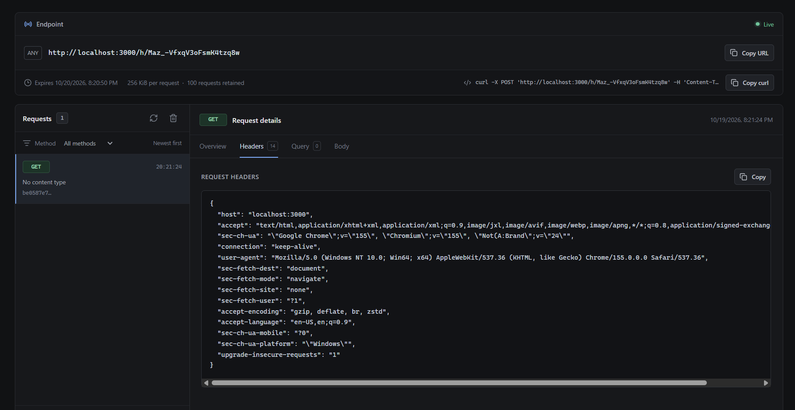
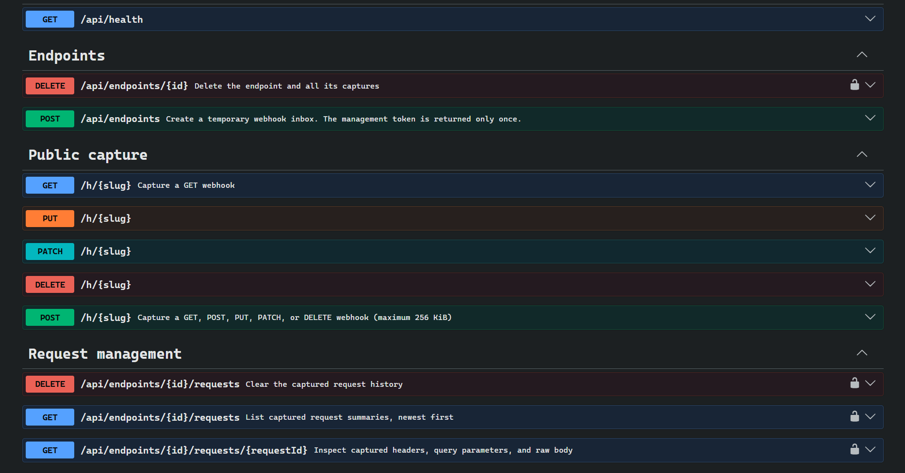

# HookLens

**A real-time webhook inspector for catching, reviewing, and understanding HTTP requests.**

<div align="center">
  
  
</div>

HookLens creates a temporary webhook URL, captures incoming requests, and lets you inspect their headers, query parameters, and bodies as they arrive. The whole stack runs locally with Docker Compose.

> **Use test data only.** Anyone with a webhook URL can send requests to it. Do not send production secrets or personal data.

## Project outcomes

- Generate a private, temporary webhook endpoint that expires after 24 hours.
- Capture `GET`, `POST`, `PUT`, `PATCH`, and `DELETE` requests, with up to 256 KiB per request and the latest 100 captures retained.
- Inspect requests live, filter the inbox by method, and review headers, query parameters, and text or binary bodies.
- View body data as formatted JSON, raw text, or Base64; copy endpoint URLs, example `curl` commands, and request data.
- Run the dashboard, API, migrations, and PostgreSQL together with one Docker Compose command. Database records persist in a named volume.

## What I learned

- How to receive arbitrary HTTP requests safely, including binary bodies, while enforcing size and retention limits.
- How temporary credentials and session storage can protect access to captured webhook data.
- How to deliver live updates with WebSockets and keep the request list in sync with the API.
- How to coordinate database health checks, schema migrations, API readiness, and frontend startup in Docker Compose.
- How to build an inspector interface that makes raw request data easy to scan on desktop and mobile.

## Technologies used and why

| Technology           | What it does in HookLens                                                     |
| -------------------- | ---------------------------------------------------------------------------- |
| React and TypeScript | Build the dashboard with reusable UI and typed request data.                 |
| Vite                 | Run the frontend during development and create its production bundle.        |
| NestJS               | Organize the API and real-time events into maintainable backend modules.     |
| PostgreSQL           | Persist endpoints and captured requests across container restarts.           |
| Prisma               | Define the data model, generate typed database access, and apply migrations. |
| Socket.IO            | Notify the dashboard when a webhook arrives or endpoint state changes.       |
| Nginx                | Serve the built frontend efficiently from the production container.          |
| Docker Compose       | Build and start the database, migration job, API, and frontend as one stack. |
| Jest and Supertest   | Exercise API behavior and integration flows against PostgreSQL.              |

## Run with Docker

Install Docker Desktop with Docker Compose. From the project folder, set up the environment once:

```sh
cp .env.example .env
```

Open `.env` and replace `POSTGRES_PASSWORD` with a local password. Then build and start the full app:

```sh
docker compose up --build
```

Keep the terminal open to see the `[DB]`, `[API]`, and `[WEB]` ready messages and any errors.

| Service          | Address                            |
| ---------------- | ---------------------------------- |
| Dashboard        | <http://localhost:5173>            |
| API              | <http://localhost:3000>            |
| Swagger API docs | <http://localhost:3000/api/docs>   |
| API health       | <http://localhost:3000/api/health> |

Select **Generate endpoint** in the dashboard, then send a request to the URL it gives you. For example, replace `<slug>` with the path from that URL:

```sh
curl -X POST http://localhost:3000/h/<slug> \
  -H 'Content-Type: application/json' \
  --data-binary '{"event":"demo","source":"my-app"}'
```

On Windows PowerShell, use `curl.exe` if `curl` resolves to a PowerShell alias.

Start the stack in the background with `docker compose up -d`, follow logs with `docker compose logs -f`, and stop it with `docker compose down`. The `postgres_data` volume preserves your data when containers stop. **`docker compose down -v` deletes the database volume and its data.**

## How the stack works

Compose starts PostgreSQL and waits for its health check, runs Prisma migrations, starts the API after migrations complete, then starts Nginx after the API is healthy. PostgreSQL stays on the internal Docker network; the API and dashboard are published on localhost.

For a webhook provider outside your machine, put an HTTPS reverse proxy in front of the API and set `PUBLIC_BASE_URL`, `FRONTEND_ORIGIN`, and `VITE_API_URL` in `.env` to the appropriate public origins. Rebuild after changing frontend build settings.

## Local development and checks

Local development requires Node.js 24.11 or newer, npm 11 or newer, and PostgreSQL. Install dependencies with `npm ci`, configure `DATABASE_URL` for your development database, and run these in separate terminals:

```sh
npm run dev:api
npm run dev:web
```

The integration suite requires a separate disposable PostgreSQL database whose name ends in `_test`. Set `TEST_DATABASE_URL` to that database; never point tests at production data.

```sh
npm run lint
npm run typecheck
npm run build
npm test
npm run test:e2e
```
